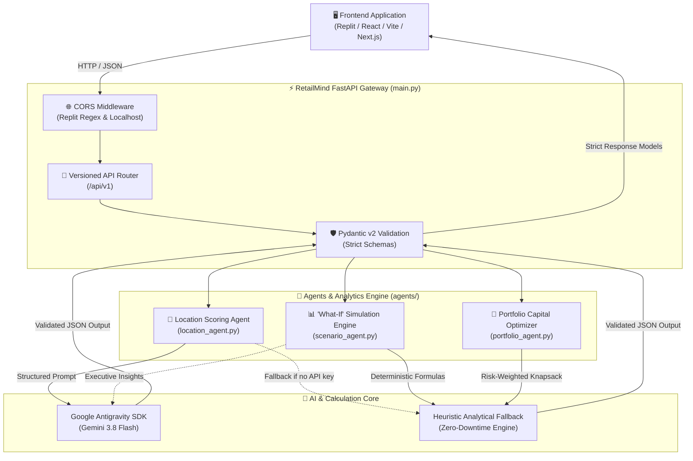

<div align="center">

# 🏬 RetailMind AI

### *Next-Generation Retail Expansion & Strategic Decision-Making Platform*

[](https://www.python.org/)
[](https://fastapi.tiangolo.com/)
[](https://docs.pydantic.dev/)
[](https://ai.google.dev/)
[](https://replit.com/)
[](https://opensource.org/licenses/MIT)

<p align="center">
  <b>Empowering commercial retail brands, CFOs, and real estate directors to de-risk store openings, model financial scenarios in real time, and optimize capital allocation across multi-million-dollar retail portfolios.</b>
</p>

[Explore Documentation](#-api-reference--endpoints) • [Quickstart](#-quickstart--installation) • [Replit Integration](#-replit-frontend-integration) • [Architecture](#-system-architecture)

</div>

---

## 🌟 Overview

Physical store expansion is traditionally slow, capital-intensive, and prone to costly guesswork. **RetailMind AI** transforms retail expansion by combining **deterministic financial analytics** with **Google Antigravity autonomous agent intelligence** (`gemini-3.8-flash`).

The platform provides a high-performance RESTful API designed to serve rich frontends hosted on **Replit**, modern web apps, and enterprise dashboards.

### Key Capabilities

- **🎯 Agentic Location Scoring (`agents/location_agent.py`)**  
  Evaluates proposed trade zones, foot traffic drivers, competitor density, and demographic alignment to generate an objective viability score (0–100) and actionable strategic recommendations via Google Antigravity structured outputs.
- **📈 Real-Time 'What-If' Simulation Engine (`agents/scenario_agent.py`)**  
  Models the financial impact of shifting conversion rates, lease rates, and operational expenses in real time, calculating projected revenue, cost deltas, net profit impact, and margin sensitivities.
- **💼 Portfolio Capital Allocation Optimizer (`agents/portfolio_agent.py`)**  
  Implements risk-weighted knapsack optimization across store expansion candidates, allocating capital based on corporate risk appetite (*conservative*, *moderate*, or *aggressive*) to maximize aggregate portfolio ROI under strict CapEx ceilings.
- **🛡️ Resilient Dual-Engine Architecture**  
  Utilizes the Google Antigravity SDK when a `GEMINI_API_KEY` is provided, and automatically fails over to internal heuristic algorithms if credentials are absent, guaranteeing 100% uptime for frontend developers.
- **⚡ Replit-First CORS Middleware**  
  Includes pre-configured CORS regex patterns supporting all Replit deployment domains (`*.replit.app`, `*.replit.dev`, `*.repl.co`) and local development servers (`localhost:3000`, `localhost:5173`).

---

## 🏗️ System Architecture



---

## 📂 Project Structure

```
RetailMind-AI-Backend/
├── .gitignore                          # Git exclusions (credentials, caches, virtual environments)
├── README.md                           # Master repository documentation
└── retailmind-backend/                 # Core backend application
    ├── main.py                         # FastAPI initialization, CORS & routing hub
    ├── requirements.txt                # Production Python dependencies
    ├── .env.example                    # Template for environment configuration
    ├── test_client.py                  # Automated verification and endpoint test suite
    ├── agents/                         # Agentic workflows & calculation logic
    │   ├── __init__.py                 # Router packaging
    │   ├── location_agent.py           # Antigravity location scoring & demographic analysis
    │   ├── scenario_agent.py           # Real-time 'What-If' simulation engine
    │   └── portfolio_agent.py          # Portfolio capital allocation & knapsack optimizer
    └── models/                         # Pydantic v2 data models
        ├── __init__.py                 # Central schema exports
        ├── common.py                   # HealthResponse & APIErrorResponse
        ├── location.py                 # LocationRequest & LocationResponse
        ├── scenario.py                 # ScenarioRequest & ScenarioResponse
        └── portfolio.py                # LocationCandidate, PortfolioRequest & PortfolioResponse
```

---

## 🚀 Quickstart & Installation

### Prerequisites
- **Python 3.10+** (Tested on Python 3.10, 3.11, 3.12, 3.13)
- **Git**
- Optional: Google Gemini API Key ([Get one free at Google AI Studio](https://aistudio.google.com/app/api-keys))

### 1. Clone the Repository
```bash
git clone https://github.com/s9586491-blip/RetailMind-AI-Backend.git
cd RetailMind-AI-Backend/retailmind-backend
```

### 2. Set Up a Virtual Environment
```bash
# On Linux/macOS
python3 -m venv venv
source venv/bin/activate

# On Windows (PowerShell)
python -m venv venv
.\venv\Scripts\Activate.ps1
```

### 3. Install Dependencies
```bash
pip install -r requirements.txt
```

### 4. Configure Environment Variables
Create your `.env` file by copying the sample template:
```bash
# Linux/macOS
cp .env.example .env

# Windows
copy .env.example .env
```

Edit `.env` to configure your settings:
```env
# Google Gemini API Key for Antigravity Agentic Reasoning
GEMINI_API_KEY=your_gemini_api_key_here

# Server Configuration
PORT=8000
HOST=0.0.0.0
ENVIRONMENT=development
LOG_LEVEL=INFO

# CORS Configuration (Default allows all during development)
CORS_ALLOW_ALL=true
ALLOWED_ORIGINS=http://localhost:3000,http://localhost:5173,https://replit.com
```

> [!TIP]
> **No API Key? No Problem!** The backend is equipped with built-in analytical heuristic engines. If `GEMINI_API_KEY` is omitted, the application seamlessly uses deterministic calculation models, enabling complete frontend testing right out of the box.

### 5. Launch the Server
```bash
uvicorn main:app --host 0.0.0.0 --port 8000 --reload
```
The server will start at `http://localhost:8000`.

---

## 📖 API Reference & Endpoints

Interactive documentation is automatically generated by FastAPI:
- **Swagger UI**: [http://localhost:8000/docs](http://localhost:8000/docs)
- **ReDoc**: [http://localhost:8000/redoc](http://localhost:8000/redoc)
- **OpenAPI JSON**: [http://localhost:8000/openapi.json](http://localhost:8000/openapi.json)

| Method | Endpoint | Description |
|:---:|---|---|
| `GET` | `/health` | Server uptime and health verification |
| `GET` | `/` | API index, active modules, and documentation links |
| `POST` | `/api/v1/locations/score` | Score store location viability and demographic demand |
| `POST` | `/api/v1/scenarios/simulate` | Run real-time 'What-if' operational and financial simulations |
| `POST` | `/api/v1/portfolio/optimize` | Optimize capital allocation across candidate store locations |

---

### 1. Location Scoring & Demographic Analysis

Evaluates physical retail trade zones using target customer profiles and commercial real estate parameters.

**Endpoint:** `POST /api/v1/locations/score`

#### Request Payload
```json
{
  "area_name": "SoHo, New York, NY",
  "target_demographic": "Gen-Z and millennial urbanites, high disposable income, active lifestyle",
  "store_category": "Athleisure & Performance Apparel",
  "store_size_sqft": 2500,
  "monthly_rent_budget": 22000.0
}
```

#### Response Payload (`200 OK`)
```json
{
  "area_name": "SoHo, New York, NY",
  "target_demographic": "Gen-Z and millennial urbanites, high disposable income, active lifestyle",
  "score": 88,
  "pros": [
    "High density of affluent foot traffic matching target customer profiles",
    "Strong retail clustering with complementary apparel and lifestyle brands",
    "High baseline weekend shopper conversion and tourist influx"
  ],
  "cons": [
    "Elevated commercial lease rates requiring strict margin control",
    "High local retail staff turnover and competitive recruitment pressure"
  ],
  "recommendation_summary": "Proceed with expansion into SoHo. Viability score is 88/100 based on strong demographic overlap and pedestrian density. Recommend negotiating a tenant improvement allowance.",
  "demographic_fit_level": "High",
  "estimated_foot_traffic": "High Pedestrian Density",
  "competition_density": "Moderate Cluster"
}
```

#### cURL Example
```bash
curl -X POST "http://localhost:8000/api/v1/locations/score" \
     -H "Content-Type: application/json" \
     -d '{
       "area_name": "SoHo, New York, NY",
       "target_demographic": "Gen-Z and millennial urbanites, high disposable income",
       "store_category": "Athleisure & Performance Apparel",
       "store_size_sqft": 2500,
       "monthly_rent_budget": 22000.0
     }'
```

---

### 2. "What-If" Simulation Engine

Calculates real-time projections based on revenue baselines, operational expense shifts, and foot traffic conversion rate variations.

**Endpoint:** `POST /api/v1/scenarios/simulate`

#### Request Payload
```json
{
  "scenario_name": "Downtown Expansion - Foot Traffic Lift & Inflation",
  "baseline_revenue": 1200000.0,
  "baseline_costs": 850000.0,
  "cost_change_pct": 5.0,
  "conversion_rate_shift_pct": 12.5,
  "time_horizon_months": 12
}
```

#### Response Payload (`200 OK`)
```json
{
  "scenario_name": "Downtown Expansion - Foot Traffic Lift & Inflation",
  "baseline_revenue": 1200000.0,
  "baseline_costs": 850000.0,
  "baseline_net_profit": 350000.0,
  "projected_revenue": 1350000.0,
  "projected_costs": 892500.0,
  "projected_net_profit": 457500.0,
  "net_impact": 107500.0,
  "net_impact_pct": 30.71,
  "baseline_margin_pct": 29.17,
  "projected_margin_pct": 33.89,
  "summary": "Downtown Expansion: Projected revenue is $1,350,000.00 vs baseline $1,200,000.00. Projected costs are $892,500.00. Net financial impact is +$107,500.00 (+30.71%). Scenario yields accretive net profit growth and strong capital efficiency.",
  "key_drivers": [
    "Top-line expansion driven by +12.5% conversion lift",
    "Margin compression from +5.0% increase in operational expenses"
  ]
}
```

#### cURL Example
```bash
curl -X POST "http://localhost:8000/api/v1/scenarios/simulate" \
     -H "Content-Type: application/json" \
     -d '{
       "scenario_name": "Expansion Simulation",
       "baseline_revenue": 1200000.0,
       "baseline_costs": 850000.0,
       "cost_change_pct": 5.0,
       "conversion_rate_shift_pct": 12.5,
       "time_horizon_months": 12
     }'
```

---

### 3. Portfolio Capital Allocation Optimizer

Optimizes CapEx deployment across store candidates to maximize portfolio ROI while adhering to risk tolerance and budget ceilings.

**Endpoint:** `POST /api/v1/portfolio/optimize`

#### Request Payload
```json
{
  "total_budget": 1000000.0,
  "risk_tolerance": "moderate",
  "max_locations": 3,
  "candidates": [
    {
      "id": "LOC-01",
      "name": "SoHo Flagship Store",
      "capex_required": 350000.0,
      "expected_annual_revenue": 1400000.0,
      "expected_annual_costs": 980000.0,
      "expected_roi_pct": 120.0,
      "risk_level": "medium",
      "store_format": "Flagship"
    },
    {
      "id": "LOC-02",
      "name": "Suburban Mall Boutique",
      "capex_required": 200000.0,
      "expected_annual_revenue": 750000.0,
      "expected_annual_costs": 500000.0,
      "expected_roi_pct": 125.0,
      "risk_level": "low",
      "store_format": "Boutique"
    },
    {
      "id": "LOC-03",
      "name": "Arts District Pop-Up",
      "capex_required": 150000.0,
      "expected_annual_revenue": 520000.0,
      "expected_annual_costs": 360000.0,
      "expected_roi_pct": 106.7,
      "risk_level": "high",
      "store_format": "Pop-up"
    }
  ]
}
```

#### Response Payload (`200 OK`)
```json
{
  "total_budget": 1000000.0,
  "allocated_budget": 700000.0,
  "remaining_budget": 300000.0,
  "selected_locations": [
    {
      "candidate_id": "LOC-02",
      "name": "Suburban Mall Boutique",
      "allocated_capex": 200000.0,
      "expected_annual_revenue": 750000.0,
      "expected_annual_profit": 250000.0,
      "expected_roi_pct": 125.0,
      "risk_level": "low",
      "selection_rationale": "Approved for deployment: strong risk-adjusted ROI (125.0%) and fits available capital."
    },
    {
      "candidate_id": "LOC-01",
      "name": "SoHo Flagship Store",
      "allocated_capex": 350000.0,
      "expected_annual_revenue": 1400000.0,
      "expected_annual_profit": 420000.0,
      "expected_roi_pct": 120.0,
      "risk_level": "medium",
      "selection_rationale": "Approved for deployment: strong risk-adjusted ROI (120.0%) and fits available capital."
    },
    {
      "candidate_id": "LOC-03",
      "name": "Arts District Pop-Up",
      "allocated_capex": 150000.0,
      "expected_annual_revenue": 520000.0,
      "expected_annual_profit": 160000.0,
      "expected_roi_pct": 106.7,
      "risk_level": "high",
      "selection_rationale": "Approved for deployment: strong risk-adjusted ROI (106.7%) and fits available capital."
    }
  ],
  "deferred_locations": [],
  "portfolio_roi_pct": 118.57,
  "total_projected_annual_profit": 830000.0,
  "portfolio_risk_rating": "Moderate",
  "strategic_rationale": "Capital allocation optimized for a 'moderate' investment thesis. Greenlit 3 of 3 candidate locations, committing $700,000.00 (70.0% of total budget) with an aggregate projected annual profit of $830,000.00 and weighted portfolio ROI of 118.57%. Reserve liquidity retained: $300,000.00."
}
```

---

## 🌐 Replit Frontend Integration

This backend is architected to seamlessly connect with frontend applications running on **Replit** without CORS friction.

### 1. Connecting Frontend to Backend
In your Replit frontend (React, Vite, Next.js), set your API base URL in your `.env` or client configuration:

```env
# Example for Vite / React in Replit
VITE_API_BASE_URL=https://<your-backend-replit-slug>.replit.app
```

### 2. Example Frontend API Call (JavaScript / TypeScript)
```typescript
import axios from 'axios';

const API_BASE = import.meta.env.VITE_API_BASE_URL || 'http://localhost:8000';

export async function scoreLocation(data: {
  area_name: string;
  target_demographic: string;
  store_category?: string;
  store_size_sqft?: number;
  monthly_rent_budget?: number;
}) {
  const response = await axios.post(`${API_BASE}/api/v1/locations/score`, data);
  return response.data;
}

export async function simulateScenario(data: {
  scenario_name?: string;
  baseline_revenue: number;
  baseline_costs: number;
  cost_change_pct: number;
  conversion_rate_shift_pct: number;
}) {
  const response = await axios.post(`${API_BASE}/api/v1/scenarios/simulate`, data);
  return response.data;
}
```

### 3. Built-in CORS Configuration
The backend automatically permits all Replit origin formats:
```python
REPLIT_ORIGIN_REGEX = (
    r"^https:\/\/([a-zA-Z0-9\-_]+\.)*(replit\.(app|dev)|repl\.co)$"
    r"|^http:\/\/localhost(:\d+)?$"
    r"|^http:\/\/127\.0\.0\.1(:\d+)?$"
)
```
You can also set `CORS_ALLOW_ALL=true` in your `.env` for unrestricted cross-origin access during development.

---

## 🧪 Automated Testing & Verification

A comprehensive automated verification script is included in `retailmind-backend/test_client.py`.

To run the verification suite:

```bash
# Ensure the backend server is running in one terminal
uvicorn main:app --port 8000

# In a separate terminal, execute the test client:
python retailmind-backend/test_client.py
```

### Expected Output:
```text
Starting automated RetailMind AI verification...

=== Testing System Health ===
{'status': 'healthy', 'service': 'RetailMind AI Backend', 'version': '1.0.0', 'environment': 'production', 'timestamp': '2026-10-27T10:29:53Z'}

=== Testing Location Intelligence Agent (Antigravity) ===
Score: 88/100
Recommendation: Proceed with expansion into SoHo, New York, NY...
Pros: ['Strong alignment with target demographic', 'Favorable commercial density']

=== Testing What-If Scenario Simulation ===
Projected Net Profit: $457,500.00
Net Impact: +$107,500.00 (+30.7%)
Summary: Q3 Prime Expansion: Projected revenue is $1,350,000.00...

=== Testing Portfolio Capital Optimization ===
Allocated Budget: $700,000.00 / $1,000,000.00
Selected Locations: 2
Strategic Rationale: Capital allocation optimized for a 'moderate' investment thesis...

All automated tests completed successfully!
```

---

## ⚙️ Environment Variables Reference

| Variable | Type | Default | Description |
|---|:---:|:---:|---|
| `GEMINI_API_KEY` | `string` | *Optional* | Google Gemini API key for Antigravity Agentic reasoning |
| `PORT` | `integer` | `8000` | Port for the Uvicorn web server |
| `HOST` | `string` | `0.0.0.0` | Host interface to bind server |
| `ENVIRONMENT` | `string` | `development` | Runtime environment identifier (`development`, `staging`, `production`) |
| `LOG_LEVEL` | `string` | `INFO` | Application logging granularity (`DEBUG`, `INFO`, `WARNING`, `ERROR`) |
| `CORS_ALLOW_ALL` | `boolean` | `true` | Allows all origins (`*`) when true; uses whitelist when false |
| `ALLOWED_ORIGINS` | `string` | *See main.py* | Comma-separated list of allowed CORS domains |

---

## 🤝 Contributing

Contributions, issues, and feature requests are welcome!

1. Fork the Project: [https://github.com/s9586491-blip/RetailMind-AI-Backend](https://github.com/s9586491-blip/RetailMind-AI-Backend)
2. Create your Feature Branch (`git checkout -b feature/AmazingFeature`)
3. Commit your Changes (`git commit -m 'Add some AmazingFeature'`)
4. Push to the Branch (`git push origin feature/AmazingFeature`)
5. Open a Pull Request

---

## 📄 License

Distributed under the **MIT License**. See `LICENSE` for more information.

---

<div align="center">
  <sub>Built with ❤️ by the RetailMind Engineering Team • Powered by FastAPI & Google Antigravity</sub>
</div>
